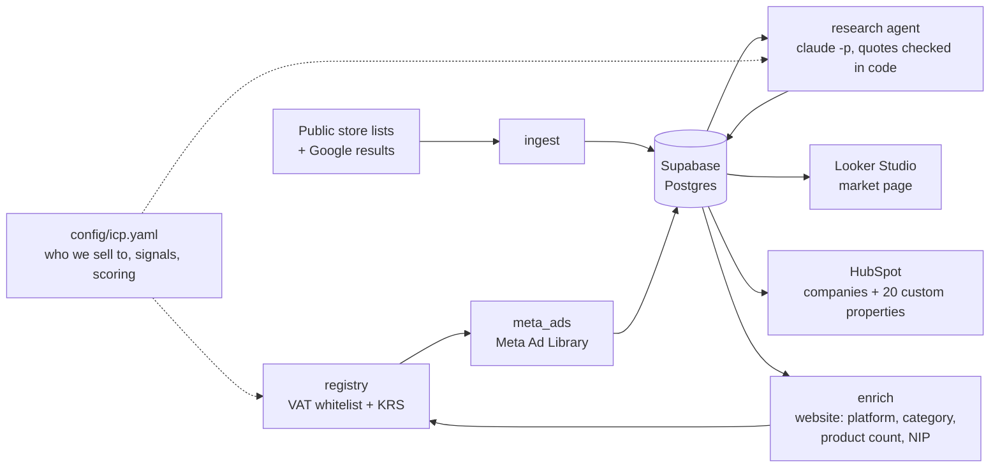

# GTM Engine

A go-to-market system that finds Polish online stores, enriches them with public registry data and website signals, scores each one against an ICP, researches it with an AI agent that has to cite a source for every fact, and syncs the result to HubSpot. Every step is measured: counts, drop-out reasons, time and cost.

The company in the scenario, **Odsyłka** (a returns-management SaaS for online stores), is fictional. The market data is real and public, and nothing is ever sent on Odsyłka's behalf. The whole system reads one file, [`config/icp.yaml`](config/icp.yaml), so pointing it at another B2B company means changing that file.

**Status (November 2026):** phase 1 (company base) is done. Phase 2 (research agent) is running on a 30-store sample and its fact accuracy is being checked by hand. Phases 3–5 (inbound form, outbound drafts, dashboard) are not built yet. See [Roadmap](#roadmap).

## Results so far

| What | Number |
|---|---|
| Store domains collected from 3 public sources | 1,235 |
| Stores matched to a company in the VAT whitelist | 966 (78.5%) |
| Stores that fit the ICP | 550 |
| ICP stores running Meta ads in Poland (checked by hand) | 340 of 550 (61.8%) |
| Research cards written by the agent (eval sample) | 30 of 30 |
| Agent facts dropped because the quote was not on the cited page | 8 of 375 (2.1%) |
| Agent time per store | ~36 s (manual research: 4.7 min) |
| Agent cost per store | ~0.14 USD at API prices (runs on a Claude subscription) |
| Data cost of phase 1 | 0.60 USD (Google results); registries and Meta Ad Library are free |
| Fact accuracy on 30 hand-checked stores | being measured (target: 85%) |

## How it works



**1. Collect stores** ([`src/collect_lists.py`](src/collect_lists.py), [`src/collect_serp.py`](src/collect_serp.py), [`src/ingest.py`](src/ingest.py)). Public registries in Poland only search by NIP or KRS number, so they cannot produce a list of companies. The list comes from public store lists (a platform's client list, a platform blog) and Google results for category queries. Every domain keeps the source it came from. Sources and their limits: [`docs/sources.md`](docs/sources.md).

**2. Read each website** ([`src/enrich.py`](src/enrich.py)). Rules, no AI: platform from the page code, product category from the menu, product count from the sitemap, and the seller's NIP (tax ID) from the terms or footer, which Polish stores must publish. Every field keeps the URL it was read from. Of 1,187 sites read, 991 showed a NIP.

**3. Match the seller in public registries** ([`src/registry.py`](src/registry.py)). The VAT whitelist API gives the registered name, VAT status and KRS number; the KRS API gives the legal form and registration date. The script records why each store dropped out: no NIP on the site (15.9%), site unreadable (3.6%), NIP not in the whitelist (2.0%), VAT not active.

**4. Score against the ICP** (SQL view [`company_icp`](sql/schema.sql), [`sql/queries.sql`](sql/queries.sql)). Category, product count, VAT status and legal form decide whether a store fits. Five SQL queries answer the business questions (how many fit, by platform, how many advertise).

**5. Buying signal: Meta ads** ([`src/meta_ads.py`](src/meta_ads.py)). The Meta Ad Library API shows whether a store runs ads in Poland now. A store is matched by the store URL under the ad, not only by page name, because page names collide: 3 of the 9 name-only matches were other companies.

**6. Research agent** ([`src/research.py`](src/research.py), [`prompts/research.md`](prompts/research.md), card format in [`docs/research-card.md`](docs/research-card.md)). For each store the script fetches up to 10 pages (returns, terms, delivery, FAQ, careers, a product listing) and asks Claude for a research card: what they sell, how returns work today, whether they are hiring, 2–3 observations a salesperson can open with, and a problem hypothesis. Every fact must name the page it came from and quote it word for word. Code checks each quote against the fetched page and drops the fact if the quote is not there. The model does not compute the fit score: code does, from `config/icp.yaml`, and the model only explains it.

**7. Evaluate the agent** ([`src/eval_research.py`](src/eval_research.py)). Builds a review workbook for a person: one row per fact with a link that opens the source page at the quoted text, and columns for true / false / cannot check. A second command turns the filled workbook into the accuracy report (`evals/research-eval.md`).

**8. CRM sync** ([`src/hubspot_sync.py`](src/hubspot_sync.py)). Creates a "GTM Engine" property group in HubSpot (fit score and label, platform, category, Meta ads, hiring, how returns work, problem hypothesis, persona to contact) and upserts one company per research card, keyed by a unique ID property, so re-running updates instead of duplicating.

**9. Market report** (Looker Studio). A read-only Postgres role sees one reporting view: stores by drop-out reason, platform, category, size, legal form and ads.

Every script that writes to the database logs its run in the `runs` table: time, counts, errors and cost.

## Design choices

- **No fact without a source.** The agent quotes, code verifies. A wrong field is worse than an empty one, so missing facts go into a `gaps` list instead of being guessed.
- **Rules first, AI where rules stop.** Platform, NIP, product count and the fit score are deterministic. The model reads only what rules cannot: return policies, observations, hypotheses.
- **One config file.** Categories, size bands, signals, disqualifiers and score weights live in `config/icp.yaml` (versioned, with a changelog); scripts and SQL read it from there.
- **Public repo, private data.** Store lists, domains and registry data stay out of git. The docs use Store A, B, C and aggregate numbers only.

## Roadmap

| Phase | What | Status |
|---|---|---|
| 0. Setup | ICP file, accounts, manual research baseline ([`docs/baseline.md`](docs/baseline.md)) | done |
| 1. Company base | collect, enrich, registry match, Meta ads, SQL, Looker Studio | done |
| 2. Research agent | research cards with checked quotes, hand evaluation on 30 stores, run on all ICP stores, HubSpot sync | in progress |
| 3. Inbound | demo form → n8n → enrichment and card → HubSpot + Slack in under 5 minutes | planned |
| 4. Outbound | signal-based vs generic message drafts for 40 stores, scored against a rubric | planned |
| 5. Dashboard and write-up | funnel dashboard, case study, 3-minute video | planned |

## Stack

Python 3.12 · Supabase (Postgres, PostgREST) · Claude (`claude -p` with a JSON schema) · HubSpot CRM API · Meta Ad Library API · Polish VAT whitelist and KRS APIs · Looker Studio · n8n (phase 3, local Docker setup in [`n8n/`](n8n/))

## Running it

The scripts need a Supabase project with [`sql/schema.sql`](sql/schema.sql) applied and a `.env` file in the repo root:

```
SUPABASE_URL=...
SUPABASE_SERVICE_ROLE_KEY=...
META_ACCESS_TOKEN=...        # Meta Ad Library
HUBSPOT_TOKEN=...            # HubSpot private app
DATAFORSEO_USERNAME=...      # only for collect_serp.py
DATAFORSEO_PASSWORD=...
```

The research agent needs the [Claude Code](https://claude.com/claude-code) CLI logged in. Run every script from the repo root; anything that writes or costs money has `--dry-run`:

```bash
python -m venv .venv && .venv/bin/pip install -r requirements.txt
.venv/bin/python src/enrich.py --limit 20 --dry-run
.venv/bin/python src/research.py store-a.example --dry-run
.venv/bin/python src/hubspot_sync.py --min-score 70 --dry-run
```

To use the system for another company, edit `config/icp.yaml`: the product, the target categories and size, the signals and the score weights.
